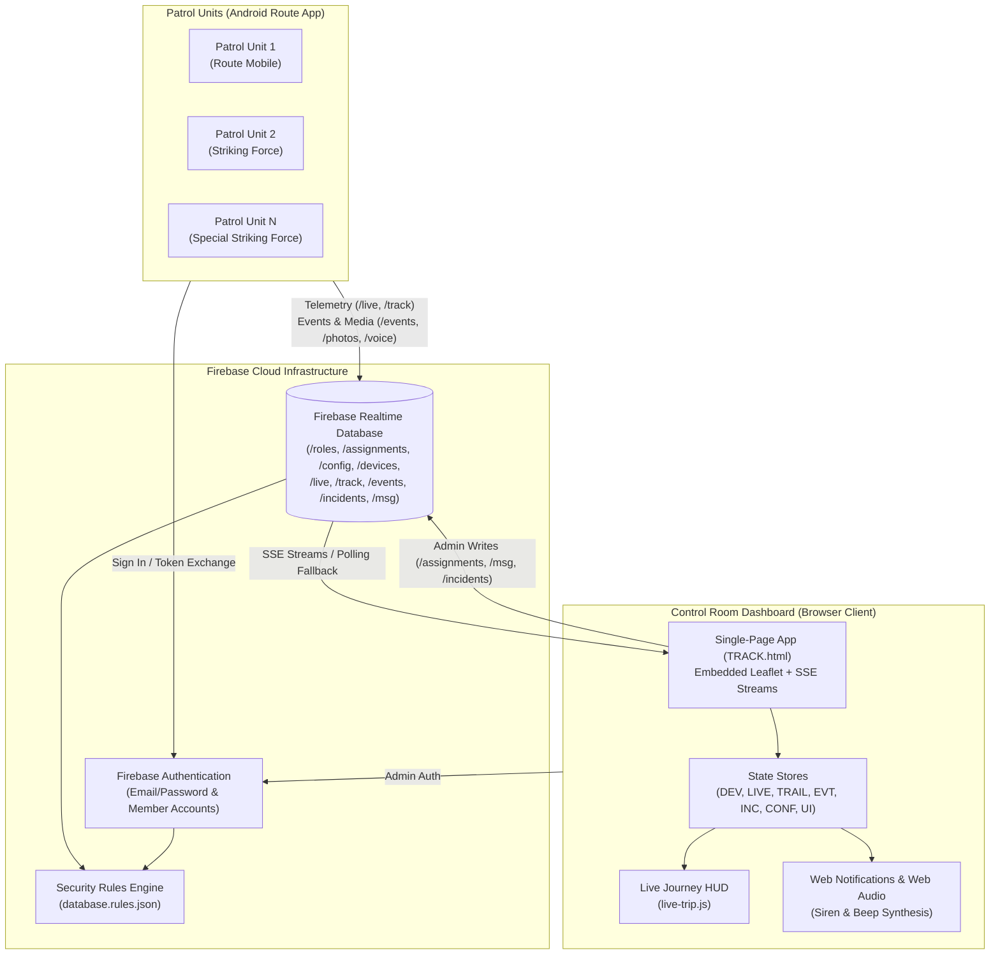
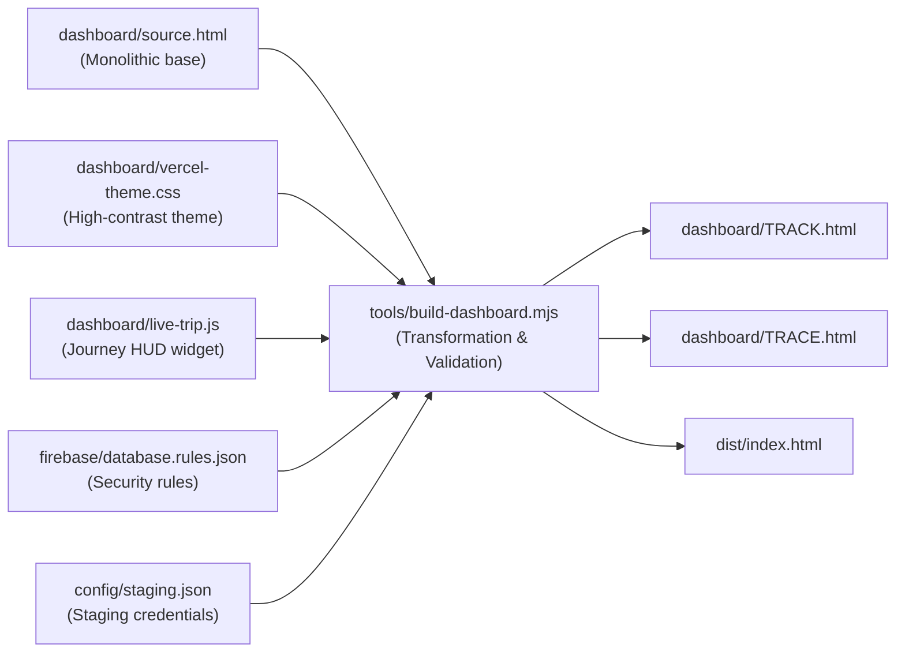
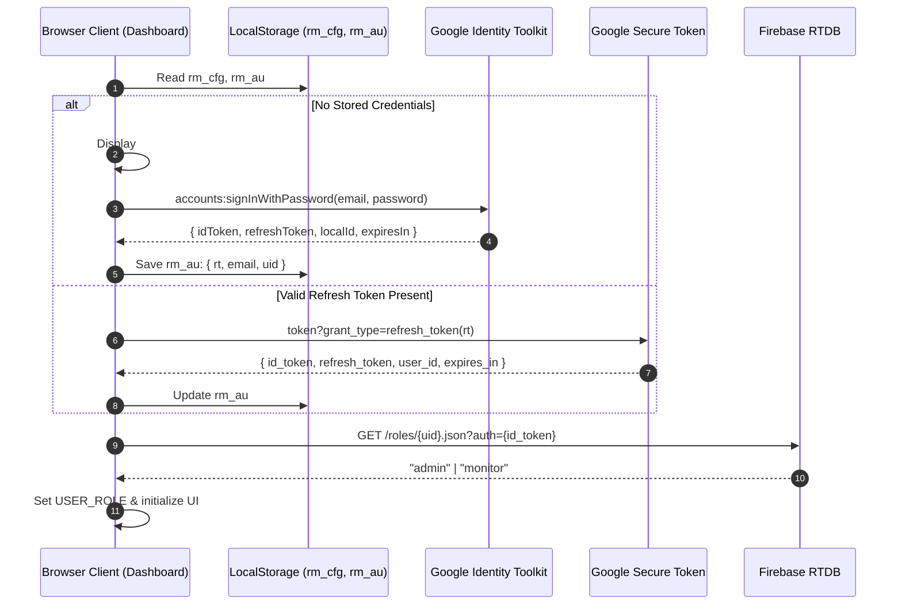
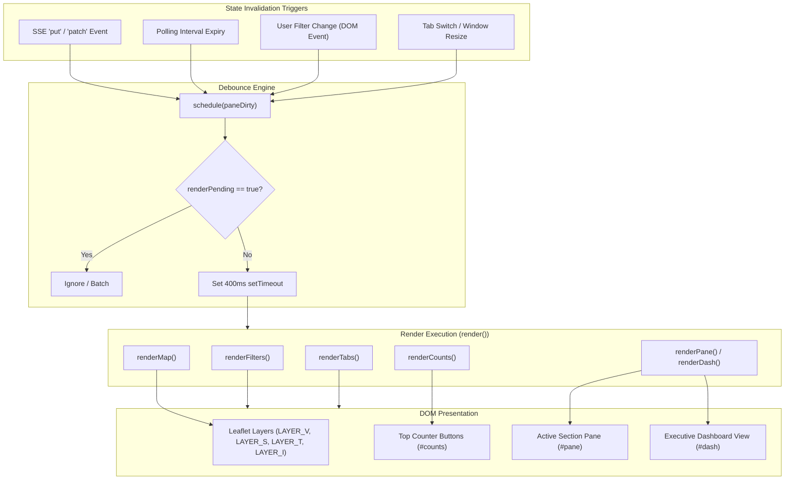
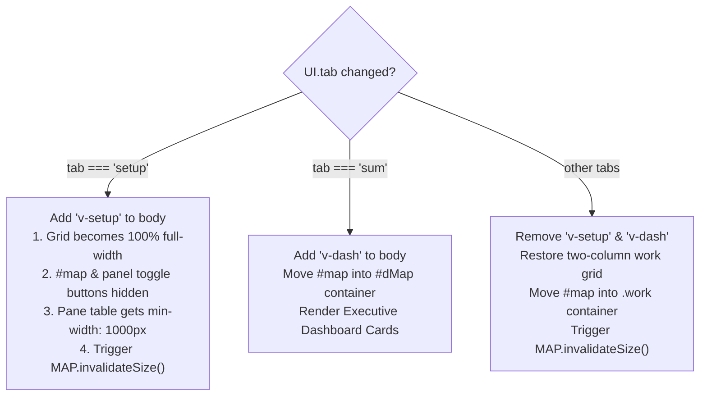

# TRACK / TRACE Codebase Architectural Analysis

**Target Codebase**: `/home/abdul-aleem-arshad-mohammed/Work/TRACE`  
**System Designation**: **TRACK** (Tactical Route Alert & Coordination Kit) / **TRACE** (Tracking Routes, Alerting & Coordinating Emergencies)  
**Deployment Jurisdiction**: East Godavari District Police (rebranded from Kakinada District Police)  
**Map Datum**: Rajamahendravaram / East Godavari (`[17.0005, 81.8040]`)  
**Date of Analysis**: November 2026  

---

## 1. System Overview & Architectural Topology

TRACK is an election and patrol operations tracking platform engineered for district police control rooms. It facilitates real-time location streaming, emergency SOS alerts, critical polling booth coverage auditing, incident dispatching, and secure field communications without requiring custom backend middleware. The entire infrastructure relies on **Firebase Realtime Database (RTDB)** and **Firebase Authentication** combined with two client entities:

1. **Android Patrol Route App (`android-route`)**: An Android mobile application deployed to patrol officers on election routes. It runs a background foreground service that samples GPS fixes, queues telemetry offline in SQLite, transmits real-time telemetry over RTDB REST endpoints, accepts dispatched incident routes, records audio/photo situation reports, and submits hourly polling turnout numbers.
2. **Control Room Web Dashboard (`dashboard/source.html` -> `dashboard/TRACK.html`)**: A high-performance, single-file operational dashboard loaded by police superintendents, sub-divisional police officers (SDPOs), and control-room dispatchers. It provides live interactive GIS mapping (Leaflet), real-time fleet metrics, dispatching tools, automated situation reports (Excel/PDF), and member account administration.



---

## 2. Build & Assembly Pipeline (`tools/build-dashboard.mjs`)

The web dashboard is delivered as a **fully self-contained, single-file HTML document** that can be hosted on static platforms (Firebase Hosting, Vercel) or opened directly from disk in field headquarters.

### 2.1 The Assembly Process

The compiler script (`tools/build-dashboard.mjs`) takes `dashboard/source.html` and transforms it into the production artifacts `dashboard/TRACK.html`, `dashboard/TRACE.html`, and `dist/index.html`.



### 2.2 Key Compilation Transformations

1. **Staging Configuration Injection**:
   - Strips placeholder configurations (`const DEFAULT_CFG = null;`).
   - Injects runtime credentials `{ k: staging.apiKey, d: staging.databaseURL, p: staging.projectId, sender: ..., appId: ... }`.
   - Validates that no unauthorized third-party Google API keys remain embedded (`AIza...` regex guard).

2. **Rebranding & Spatial Origin Realignment**:
   - Replaces Kakinada District Police references with **East Godavari District Police**.
   - Replaces TRACE nomenclature with **TRACK** (*Tactical Route Alert & Coordination Kit*).
   - Replaces the initial Leaflet map center from Kakinada (`[16.96, 82.24]`) to Rajamahendravaram / East Godavari (`[17.0005, 81.8040]`).
   - Replaces static logos with high-contrast styled badge marks (`<div class="trace-mark">TRACK</div>`).

3. **Operational Hardening & Human-in-the-Loop Safety**:
   - Removes static officer names/phone tables to protect personnel PII from public HTML bundles.
   - Disables automatic SOS dispatching (`autoSos: false`) and removes the `autoDispatch()` loop, ensuring police backup dispatch requires deliberate operator verification and human authorization.

4. **Web Standards & Hybrid Bridge Augmentations**:
   - Replaces WebView-only notifications with a dual-mode fallback: native Android WebView bridge (`Android.notify()`) if running inside the Android wrapper, or W3C HTML5 `new Notification()` API when run in desktop browsers.
   - Hooks alert audio permissions to user gesture clicks on the notification bell (`#bellBtn`).
   - Injects the compiled JSON string of `firebase/database.rules.json` directly into `rulesText()`, allowing administrators to view and copy current rules from the Setup tab.

5. **Style & Extension Inlining**:
   - Bundles `dashboard/vercel-theme.css` inside `<style>` directly before `</head>`.
   - Injects `dashboard/live-trip.js` immediately before `</script></body></html>`.

---

## 3. Core State Architecture & Key Data Structures

State in TRACK is managed via global reactive dictionaries. These data structures are populated via Firebase Server-Sent Events (SSE) or REST polling, synchronized with local DOM caches, and consumed by map layers and tab panels.

| Data Structure | Type | Database Path | Ownership / Mutability | Schema / Representation |
| :--- | :--- | :--- | :--- | :--- |
| `DEV` | `Object.<string, Object>` | `/devices` | Control Room / Assigned Device | Vehicle and patrol assignment metadata. Keyed by device `uid`. |
| `LIVE` | `Object.<string, Object>` | `/live` | Device Telemetry Stream | Real-time GPS and device diagnostics. Keyed by device `uid`. |
| `TRAIL` | `Object.<string, Array>` | `/track/{uid}/{YYYYMMDD}` | Reconstructed from Batches | Chronological breadcrumbs for the current day. |
| `EVT` | `Object.<string, Object>` | `/events` | Device / Operator Ledger | Operational events, SOS alerts, status reports, voice notes. |
| `INC` | `Object.<string, Object>` | `/incidents` | Control Room Dispatchers | Formal emergency incident records with response lifecycle. |
| `CONF` | `Object.<string, Object>` | `/config` | Control Room Administrators | Static configuration (routes, polling stations, operational thresholds). |
| `UI` | `Object` | *Client-Side Only* | Browser Session (`localStorage`) | Active tab, selected unit, active filters, modal states. |

### 3.1 `DEV` (Device & Patrol Unit Registry)
Represents patrol units known to the system. Populated from `/devices.json`:
```javascript
DEV[uid] = {
  sd: "Rajahmundry",         // Sub-division name
  ps: "Bommaru PS",          // Police station jurisdiction
  route: "Route 3",          // Route designation (e.g. "Route 3")
  force: "route",            // Unit type: "route" | "sf" (Striking) | "ssf" (Special Striking)
  officer: "SI K. Ramesh",   // Officer rank and name
  mobile: "+919876543210",   // Contact mobile number
  model: "Samsung Galaxy",   // Hardware model reported by device
  v: "2.2.0",                // Installed client app version
  setup: 1730560000000,      // Epoch registration timestamp
  el: "Election 2026"        // Associated election designation
};
```

### 3.2 `LIVE` (Real-Time Telemetry Snapshot)
Maintained by the active background foreground service on each phone. Written to `/live/{uid}.json`:
```javascript
LIVE[uid] = {
  lat: 17.00052,             // Current latitude (WGS84 decimal degrees)
  lng: 81.80401,             // Current longitude (WGS84 decimal degrees)
  t: 1730563200000,          // Epoch timestamp of GPS fix
  up: 1730563201500,         // Epoch timestamp of database receipt
  gps: true,                 // Boolean: GPS hardware active vs disabled
  spd: 28.5,                 // Ground speed in km/h
  hdg: 142.0,                // Heading in degrees (0-360)
  acc: 8.0,                  // Horizontal accuracy in metres
  bat: 82,                   // Battery percentage (0-100)
  sig: 4,                    // Cellular signal strength (0-4)
  chg: false,                // Boolean: whether battery is currently charging
  duty: true,                // Boolean: whether officer has active duty started
  sessionId: "s_xyz123"      // Unique UUID of current duty shift
};
```

### 3.3 `TRAIL` (Chronological Trail Points)
Compiled on startup and continuously appended from the live telemetry stream:
```javascript
TRAIL[uid] = [
  // [epochTimestamp, latitude, longitude, accuracyMetres, speedKmH]
  [1730550000000, 17.0001, 81.8035, 6, 24],
  [1730550015000, 17.0008, 81.8039, 5, 29]
];
```

### 3.4 `EVT` (Operational Event Ledger)
Chronological stream from `/events.json`. Tracks critical patrol actions:
```javascript
EVT[eventId] = {
  id: "evt_101",
  type: "sos" | "loc" | "reached" | "votes" | "photo" | "msg" | "start" | "stop" | "blocked",
  uid: "officer_uid",
  t: 1730564000000,
  lat: 17.0010,              // Optional fix coordinates
  lng: 81.8042,
  sid: "s_booth_12",         // Polling station ID (for "loc" or "votes")
  sname: "ZPHS Gokavaram",   // Polling station name
  status: "normal" | "crowd" | "tension" | "problem",
  note: "Minor argument outside queue",
  n: 450,                    // Vote count (for type="votes")
  pid: "photo_uuid",         // Photo reference ID
  voice: "voice_uuid",       // Audio clip reference ID
  ackBy: "admin@police.gov", // Email of control-room operator who resolved
  ackAt: 1730564500000,
  cleared: false             // Whether SOS has been dismissed from alert view
};
```

### 3.5 `INC` (Incident Management Register)
Maintained at `/incidents.json` to manage dispatches and track response times:
```javascript
INC[incidentId] = {
  no: 1,                     // Incident sequential daily identifier
  t: 1730565000000,          // Time incident reported
  lat: 17.0125, lng: 81.8150,// Location coordinates
  place: "Gandhi Chowk",     // Location text
  desc: "Group confrontation near booth entrance",
  status: "open" | "sent" | "reached" | "closed",
  by: "operator@police.gov", // Operator email
  dev: "officer_uid",        // Assigned unit UID
  sentAt: 1730565100000,     // Timestamp dispatch instruction sent
  reachedAt: 1730565700000,  // Auto-calculated when unit reaches within 150m
  closedAt: 1730566800000,   // Timestamp resolved
  action: "Dispersed gathering, peaceful voting resumed"
};
```

### 3.6 `CONF` (Static Configuration Tree)
Synchronized from `/config.json`:
- `CONF.routes`: Dictionary of authorized route beats (`{ [routeId]: { ps, route, sd, force, villages, officer, mobile, memberUid, coverageStatus } }`).
- `CONF.stations`: Polling locations (`{ [stationId]: { name, lat, lng, cat, ps, route, el, voters } }`).
- `CONF.settings`: System parameters (`{ nosig: 5, stop: 15, offkm: 2, pin: "0000", trail: 60, sound: true, election: "Election 2026", visitR: 200, green: 60, red: 120, pollStart: "07:00", pollEnd: "17:00", voteRemind: 60, autoSos: false, gkey: "" }`).

### 3.7 `UI` (Client View State)
Controls interactive UI states, preserved in `localStorage`:
```javascript
UI = {
  tab: "sum",                // Active tab: sum | veh | alerts | loc | inc | replay | report | setup
  sel: null,                 // Currently selected vehicle UID
  fStatus: "",               // Status filter: move | stop | nosig | gps | sos
  fSd: "",                   // Filter by Sub-division
  fPs: "",                   // Filter by Police Station
  fForce: "",                // Filter by force type: route | sf | ssf
  q: "",                     // Free-text search term
  inc: null,                 // Pending incident location marker
  incMode: false,            // Map crosshair click-to-mark toggle
  incSel: null,              // Selected incident ID
  replay: null,              // Active replay session parameters { u, day, pts, pos }
  setupOpen: "routes",       // Currently open details section in setup
  locF: "r",                 // Polling station filter: r (red) | y (yellow) | hot | all | votes
  locSel: null               // Selected polling station ID
};
```

---

## 4. Lifecycle & Communication Protocols

### 4.1 Authentication & Session Lifecycle

The dashboard connects to Firebase via REST API rather than the heavy client SDK, ensuring fast load times and minimal memory footprint.



- **Session Continuity**: Every 60 seconds, an automated interval timer inspects `ID_EXP - Date.now()`. If expiration is within 10 minutes, `refreshToken()` is executed against `https://securetoken.googleapis.com/v1/token`.
- **Hybrid Bridge**: If running inside an Android WebView (`typeof window.Android !== 'undefined'`), `bridgeAuth()` executes `Android.setAuth(...)` to synchronize authentication credentials with the native Android container.

### 4.2 Streaming Protocol & Connection Management (`stream()`)

Real-time synchronization uses HTTP Server-Sent Events (SSE) via the standard browser `EventSource` API, connected to `${CFG.d}/${path}.json?auth=${idToken}${query}`.

- **Tree Mutation (`setAt`)**: When SSE emissions arrive (`event: put` or `event: patch`), the payload contains `{ path: "/<subpath>", data: <value> }`. The helper `setAt(target, path, data, patch)` mutates the target local dictionary without re-instantiating the entire collection.
- **Failover to Interval Polling**:
  - In restricted corporate networks or unstable 4G conditions where SSE connections drop or fire HTTP 403/401 errors, `s.es.onerror` counts consecutive failures.
  - Upon 2 consecutive failures or connection aborts (`readyState === 2`), the stream switches to `mode = 'poll'`.
  - It records `localStorage.setItem('rm_poll', '1')` and triggers `setInterval(s.poll, s.every)`.
- **Incremental Event Streams**:
  - The `events` stream utilizes `&orderBy="t"&startAt=${Date.now() - 6*HOUR}` with `inc: 't'`.
  - During interval polling, it issues queries with `startAt=${s.last + 1}`, fetching only newly recorded events and preventing large payload re-downloads.

---

## 5. UI Rendering Pipeline & Event Bus Architecture

The user interface follows a functional, reactive rendering pattern with debounced frame scheduling.



### 5.1 Vehicle Glide Interpolation (`moveMarker`)

Instead of jumping abruptly between 15-second GPS updates, vehicles glide smoothly along actual travelled roads using `requestAnimationFrame`:
1. When a new GPS fix arrives, `moveMarker(u, marker, liveData)` checks if movement distance $d$ is between 3m and 5000m.
2. It gathers all intermediate trail points recorded between the previous and current timestamps (`TRAIL[u]`).
3. It constructs a piecewise cumulative distance spline.
4. `glideFrame(now)` runs at display refresh rate (60/120Hz), interpolating the vehicle coordinates along the road curve over 80% of the update interval duration ($2\text{s} \le \text{duration} \le 20\text{s}$).

### 5.2 Polling Station Coverage & Spatial Hashing

To track whether patrol units have visited polling locations without scanning thousands of coordinates naively on every frame:
1. `buildGrid()` partitions the geographic bounding box into spatial buckets of `CELL = 0.004` degrees (~440m).
2. `updateVisits()` iterates through today's `TRAIL[u]` fixes. For each fix, it inspects only the 9 neighboring spatial buckets.
3. If distance is $\le S().visitR$ (default: 200m), it logs a visit in `VISIT[stationId]`.
4. `cover(stationId)` assigns a color indicator based on elapsed time since the last visit:
   - **Green**: Visited within `< 60` minutes.
   - **Yellow**: Visited within `60 - 120` minutes.
   - **Red**: No visit recorded for `> 120` minutes or never visited today.

---

## 6. Security Architecture & Role-Based Access Control

The database is fortified by `firebase/database.rules.json`. The rules enforce a clear separation of privileges between administrators, monitors, and field route officers.

```mermaid
graph TD
    User([Authenticated User]) --> CheckRole{Role Lookup\n/roles/$uid}

    CheckRole -->|admin| AdminPerms[Full Administrative Access\n- Read & Write All Paths\n- Manage Roles & Assignments\n- Dispatch & Close Incidents\n- Edit Routes & Stations]

    CheckRole -->|monitor| MonitorPerms[Read-Only Monitoring\n- Read /devices, /live, /track\n- Read /events, /photos, /voice\n- Read /config, /incidents\n- Zero Write Permissions]

    CheckRole -->|route| RoutePerms[Restricted Field Unit\n- Read own role & assignment\n- Read /config and /lock\n- Write ONLY own /devices/$uid\n  (Must match approved assignment!)\n- Write ONLY own /live/$uid and /track/$uid\n- Append-only /events, /photos, /voice]

    CheckRole -->|null / unauthenticated| Denied[DENY ALL ACCESS]
```

### 6.1 Assignment Integrity & Anti-Spoofing Rule
A critical security check in `database.rules.json` guarantees that patrol phones cannot spoof their jurisdiction or hijack unassigned beats:
```json
"devices": {
  "$uid": {
    ".write": "auth != null && (root.child('roles').child(auth.uid).val() == 'admin' || (auth.uid == $uid && root.child('roles').child(auth.uid).val() == 'route' && root.child('assignments').child(auth.uid).exists() && newData.child('ps').val() == root.child('assignments').child(auth.uid).child('ps').val() && newData.child('route').val() == root.child('assignments').child(auth.uid).child('route').val()))"
  }
}
```
Field units can only update `devices/$uid` if their incoming `ps` and `route` match the signed assignment record pre-authorized by an administrator in `/assignments/$uid`.

### 6.2 Administrator Member Provisioning Workflow

To provision a mobile account without disrupting the active control-room admin session:
1. `provisionMember(routeId, member)` computes a deterministic, isolated authentication identity:  
   `email = "phone" + nationalNumber + "@members.track.invalid"`.
2. It invokes `memberAuth('signUp')` via Firebase Auth REST API. If the email already exists, it verifies the password with `memberAuth('signInWithPassword')`.
3. **Admin Session Guard**: It explicitly discards the returned user token from memory and does **not** update `AU` or `ID_TOKEN`. The control-room administrator remains authenticated under their own admin identity.
4. It executes an atomic multi-path update via `dbPatch('/')`:
   - Sets `roles/${officerUid} = 'route'`.
   - Sets `assignments/${officerUid} = { ps, route, sd, election, officer, mobile }`.
   - Updates `config/routes/${routeId}` with `memberUid`, `officer`, and `mobile`.
5. **Coverage Plan Review Gate**: If a route was generated by a consolidation or split algorithm (`coverageStatus === 'proposed'`), `provisionMember` strictly prohibits assignment until the administrator checks the verification box (`member.coverageReviewed === 'on'`).

---

## 7. Responsive Layout Integration & Recent Architectural Enhancements

Recent engineering updates resolved UI clipping, map rendering failures, and viewport-specific layout bugs across devices ranging from 390px mobile viewports up to 1920px 4K control-room monitors.



### 7.1 Dedicated Settings View Mode (`body.v-setup`)
The administration table in the Setup tab contains 7 dense columns (Election, Sub-division, Police Station, Route, Villages, Officer, Action buttons). When constrained in the standard 400px side panel, text cells experienced unreadable vertical wrapping and button overflow.

The system now enforces a dedicated view state via `applyView()`:
- Toggling `body.classList.toggle('v-setup', UI.tab === 'setup')`.
- CSS in `dashboard/vercel-theme.css`:
  ```css
  body.v-setup .rd .work {
    grid-template-columns: minmax(0, 1fr);
    grid-template-rows: minmax(0, 1fr);
  }
  body.v-setup .rd .work #map,
  body.v-setup #panelBtn,
  body.v-setup #panelShow {
    display: none;
  }
  body.v-setup .rd .work aside.panel {
    display: flex;
    min-width: 0;
    border: 0;
    background: #fff;
  }
  body.v-setup .rd .pane table.t {
    min-width: 1000px;
  }
  body.v-setup .rd .pane .tw {
    max-height: 60vh;
  }
  ```
- **Map Invalidation Guarantee**: When leaving the Setup tab, `MAP.invalidateSize()` is invoked via a 30ms deferred timer, preventing Leaflet from rendering gray, blank map tiles when restored to visibility.

### 7.2 Live Journey HUD Widget (`dashboard/live-trip.js`)
A decoupled, floating journey widget (`section.trace-trip`) docks to the bottom of the map:
- Periodically samples the selected unit (`UI.sel` or first active vehicle in `devIds()`).
- Traverses `TRAIL[uid]` and calculates the cumulative distance travelled today in kilometers via `hav()` (excluding gaps $> 20$ minutes where the vehicle was stationary).
- Evaluates stale telemetry thresholds (`Date.now() - live.t > 2 * MIN`).
- Identifies the nearest polling location on the vehicle's assigned beat.
- Listens for incoming audio dispatches (`e.voice`), displaying a direct playback button hooked to `playVoice()`.

### 7.3 Multi-Viewport Playwright Test Matrix (`tests/dashboard.spec.mjs`)
The test suite validates responsive integrity across 5 standard viewport widths:
- **1920px**: High-resolution dispatch command desks.
- **1536px**: Standard police operations laptops.
- **1280px**: Compact field workstations.
- **768px**: Tablet devices (iPad / field dispatch terminals).
- **390px**: Handheld mobile inspection screens.

Tests assert:
1. `document.documentElement.scrollWidth <= innerWidth + 1` (zero horizontal page blowouts).
2. Zero clipped content across `.hdr`, `.bar`, `.cnt`, `.pane`, `.donut li`, and `.dash .ch`.
3. In Setup tab, `#map` is completely hidden and the configuration table expands to $\ge 1000\text{px}$ width within an independently scrollable wrapper.
4. Member provisioning correctly signs up accounts via Google Identity Toolkit, writes permissions to RTDB, and leaves the administrator's active session undisturbed.

---

## 8. Verification & Operational Guidelines

### 8.1 Build & Test Commands
```bash
# Compile and rebrand dashboard artifacts (TRACK.html, TRACE.html, dist/index.html)
npm run build

# Run Playwright responsive and functional test suite across all 5 viewports
npm test

# Run Firebase security rules test suite against local emulator
npm run test:rules
```

### 8.2 Production Verification Checklist
- [x] Verify API key safety: No embedded private production keys in public HTML.
- [x] Verify human-in-the-loop dispatch: Auto-dispatch loop disabled; operator must confirm unit assignment.
- [x] Verify security rules: Staging and production RTDB instances enforce `database.rules.json`.
- [x] Verify mobile app version alignment: Patrol phones run version matching `version.json` (v2.2.0, versionCode 4).
- [x] Verify route reconciliation: All 152 routes have explicit coverage status; proposed consolidations require administrative sign-off before field assignment.
